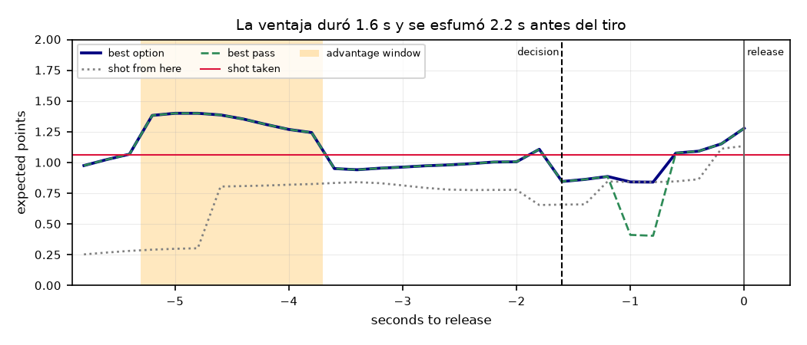
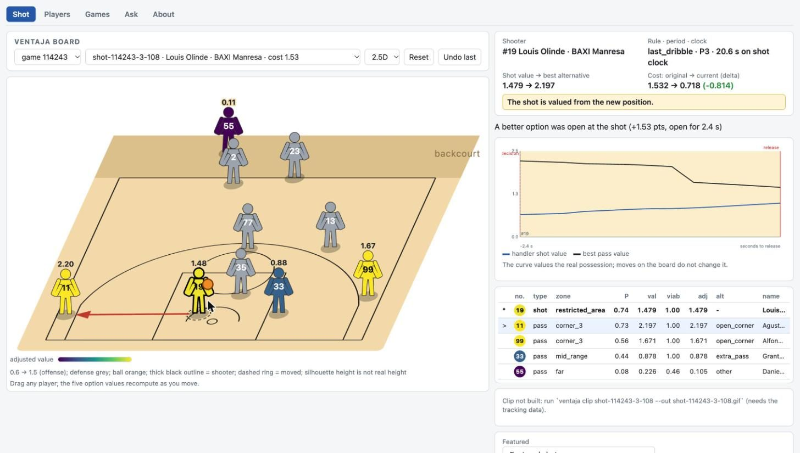

# ventaja

Basketball tracking analytics for the SkillCorner x PySport Analytics Cup.

## Data

Raw SkillCorner data and the tidy parquet build live outside the repo, in two directories set by environment variables:

- `VENTAJA_DATA_DIR`: raw data in the SkillCorner layout (default `~/.cache/ventaja/raw`).
- `VENTAJA_BUILD_DIR`: tidy parquet build (default `~/.cache/ventaja/build`).

To reuse a clone of `github.com/SkillCorner/opendata-basketball`, point `VENTAJA_DATA_DIR` at its `data/` folder.

```bash
uv run ventaja data pull --game 114243     # or --all (~380 MB)
uv run ventaja data build --game 114243
uv run ventaja validate score --game 114243
uv run ventaja sql "select count(*) from shots"
uv run ventaja snapshot shot-114243-1-0
```

## Decisions

Each shot is valued against the best viable pass at the decision frame; the cost is `max(0, best alternative - shot)` in expected points. Method: [ADR-0003](docs/decisions/0003-frame-de-decision.md) (decision frame), [ADR-0004](docs/decisions/0004-modelo-de-valor-y-viabilidad.md) (value model).

Across 10 games there are 1,459 shots, of which 1,351 are valued (108 excluded). Leave-one-game-out validation gives logloss 0.642, Brier 0.226 and AUC 0.654, with a Pearson correlation of 0.58 against SkillCorner's `shotQuality`. The mean decision cost is 0.199 points. In 48 shots (under 2 s of shot clock, or a clock that has just run out) no pass is viable, so there is no read; of the other 1,303, 41% are a good read. A raw shot clock of 0.0 is read as off, unless it just counted down ([ADR-0007](docs/decisions/0007-reloj-de-posesion-apagado.md)).

`models/value_model.json` and `artifacts/decisions/` ship in the repo. They are derived artifacts: regenerate, never edit.

```bash
uv run ventaja model train --all          # refit models/value_model.json
uv run ventaja decisions build --all --out artifacts/decisions

uv run ventaja model report
uv run ventaja decisions show shot-114243-1-0
uv run ventaja validate decisions --all --allow-fail cost_falls_with_clock
uv run ventaja review sample --all --n 20 --seed 7 --out docs/review/2026-11-sample
```

On the 10 games, `cost_falls_with_clock` fails (mean cost 0.164, 0.205 and 0.184 for 24-14, 14-6 and 6-0 s). It is deliberately not tuned (ADR-0004): a diagnostic for the [live review](docs/review/README.md), so CI passes it with `--allow-fail`.

## Lost moments

Layer 2 replays the valuation every 0.2 s along the possession; the curve marks an advantage wherever the best pass beats the shot taken by at least 0.10 points. The verdict says whether the last window had already closed (`late`), was still open at the decision (`during`), or never existed (`none`). Method: [ADR-0006](docs/decisions/0006-curva-de-ventaja-y-reel.md).



*A pass worth 1.41 points was open for 1.6 s and closed 2.2 s before the decision; the shot was worth 1.07.*

Of the 1,351 valued shots, 46% are `during`, 36% `late`, 16% `none` and 2% have too short a curve to judge. 217 late windows belong to the shooter, and in 208 of them he kept the ball while the window closed.

```bash
uv run ventaja curves show shot-114243-1-0
uv run ventaja clip shot-114243-1-0 --out clip.gif      # court + curve; needs `data build`
uv run ventaja reel rankings --all --n 10                # worst decisions, best reads, lost moments
uv run ventaja reel build --all --n 10 --out docs/reel/2026-11
```

`artifacts/curves/` ships in the repo, read like the decisions; regenerate it with `uv run ventaja curves build --all --out artifacts/curves`.

## Player cards

A card sets a player's decisions in the tracked games (value of his shots against the best pass, cost by shot clock, ignored alternatives, lost moments) beside his season profile from SkillCorner aggregates, with a rule-based phrase. Method: [ADR-0008](docs/decisions/0008-ficha-de-jugador.md).

```bash
uv run ventaja player show "Russell"
uv run ventaja player rank --min-shots 8
uv run ventaja player team "Madrid"
```

Abridged output (in Spanish):

```text
DeWayne Russell · Leche Rio Breogan · 30 tiros (30 legibles) · 2 partidos
Valor
  tiro 0.748 vs mejor alternativa 1.076  [liga 0.959 vs 1.017]
  coste medio 0.367  [liga 0.199]
  valor de las alternativas descontado por la viabilidad del pase (carril, distancia, reloj < 2 s)
Por reloj
  tramo     n   coste    liga
  24-14    11   0.292   0.164
  14-6     11   0.390   0.205
  6-0       7   0.502   0.234
Suele tener un pase mejor disponible; la opción que más deja pasar es el pase extra; su coste es más alto con el reloj agotándose.
```

Cards cover 10 games: 190 players have one from a single valued shot (median 6 shots), and `n` is always shown. The phrase only claims tendencies with at least 8 readable shots, and its clock clause compares each bucket with the league's. Lost moments on the card use the reel's 2.5 s clock floor (shooter held the ball while a window closed: 13.5% of shots).

`artifacts/players.parquet` and `teams.parquet` ship in the repo; `uv run ventaja player build --out artifacts` regenerates them.

## App

```bash
uv run ventaja app
```

One local page opens on the Shot view: the whiteboard beside the advantage curve of the same possession, for the worst valued decision by the reel's rule. Drag any of the ten players on the decision frame (2.5D view by default, 2D toggle) and the values recompute at once; the curve values the real possession, so it does not move. Then Players, Games, Ask (the MCP tools as forms) and About. It runs from packaged artifacts, with no tracking download; `ventaja board` is an alias. Method and limits: [ADR-0009](docs/decisions/0009-pizarra.md) (whiteboard), [ADR-0011](docs/decisions/0011-app-unificada.md) (app).



*Louis Olinde dragged into the restricted area: the decision cost falls from 1.53 to 0.72.*

## Ask the court

An MCP server lets Claude Code, Claude Desktop or any MCP client query the packaged artifacts in plain language, with no API key. Method and limits: [ADR-0010](docs/decisions/0010-mcp.md).

```bash
claude mcp add ventaja -- uv run --directory /path/to/ventaja ventaja mcp serve
```

Claude Desktop: `{"mcpServers": {"ventaja": {"command": "uv", "args": ["run", "--directory", "/path/to/ventaja", "ventaja", "mcp", "serve"]}}}`

Tools: `list_games`, `rank_players`, `player_profile`, `find_shots`, `explain_shot`, `what_if`.

*Who decides worst at Breogan with the clock running out?* DeWayne Russell: 0.50 points of cost over 7 shots with 6 s or less, against 0.37 over his 30.

```bash
uv run ventaja mcp call rank_players '{"team": "Breogan", "clock": "6-0"}'
```

## Development

```bash
uv sync
uv run pytest
```
